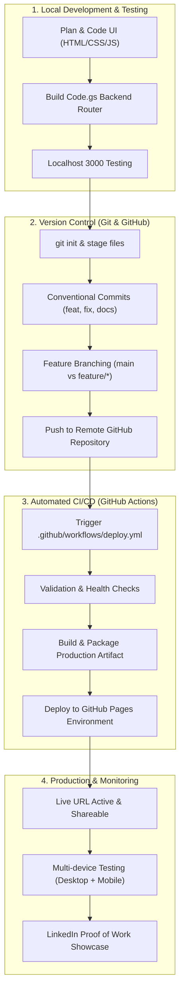

# 🎓 SPSU Udaipur Championship • DevOps & Deployment War Arena
## Student Placement Tracker — Production Release & Live Deployment


> **Day Mission:** Move from writing code locally to delivering a production-ready, version-controlled, and deployed web application with an automated CI/CD pipeline and comprehensive testing evidence.

---

## 🌐 Live Deployment & Project Links

| Resource | Target Link |
|:---|:---|
| 🚀 **Live Production Application** | [https://abhay-kumawat.github.io/DEV-OPS/](https://abhay-kumawat.github.io/DEV-OPS/) |
| 💻 **GitHub Source Repository** | [https://github.com/abhay-kumawat/DEV-OPS](https://github.com/abhay-kumawat/DEV-OPS) |
| 📊 **Google Sheet Persistence Tab** | `Students` tab on connected Google Sheet |
| ⚙️ **Google Apps Script Web App** | Executable REST-like Web App endpoint |

---

## 📌 Executive Summary & Problem Statement

### The Problem
During college placement drives, placement cells and student coordinators face friction tracking candidate readiness across technical domains (Java Full Stack, Data Analytics, Python, Cloud, UI/UX, AI/ML) and changing interview statuses. Relying on complex database servers introduces maintenance overhead and credential vulnerabilities for student projects.

### The Solution
The **Student Placement Tracker** is a lightweight, responsive single-page web application (SPA) backed by **Google Sheets** via a serverless **Google Apps Script** Web App. It delivers complete CRUD capabilities, real-time KPI metrics, search, filtering, CSV export, and celebration micro-interactions without costly database infrastructure.

---

## 🔄 End-to-End DevOps & Deployment Pipeline



---

## 🌟 Key Application Features

- 🎨 **Modern Glassmorphic UI:** Smooth keyframe animations (`@keyframes floatGlow`, `@keyframes editGlow`), dark/light theme switcher, and responsive grid.
- ⚡ **Full 4-Stage CRUD Lifecycle:**
  - **Create:** Add student details with validation and unique timestamp ID.
  - **Read:** Fetch live records, render into responsive directory table, and calculate live KPI stats.
  - **Update:** Pre-fill form in glowing *Edit Mode* and modify records in place.
  - **Delete:** Safe removal with custom animated confirmation modal.
- 📊 **Real-time Placement KPI Dashboard:** Dynamic counters for Total Candidates, Learning, Interview Ready, Placed, and Placement Success Rate (%).
- 🔎 **Instant Search & Multi-Filters:** Search by name or email, filter by technical domain, or click quick status chips.
- 📑 **Candidate Placement Dossier:** Click any student row or view icon (`👁️`) for a student readiness summary modal.
- 📥 **One-Click CSV Export:** Export filtered candidates for recruitment drives.
- 🎉 **Canvas Confetti Particles:** Automatically triggers celebratory confetti when a candidate achieves "Placed" status!
- 🔄 **Dual Engine (Zero-Friction Fallback):** Pre-loaded with local demo data in `localStorage` for immediate offline evaluation, with 1-click connection to live Google Sheets.

---

## 🛠️ Tech Stack & DevOps Tooling

| Layer | Technology | Purpose |
|:---|:---|:---|
| **Frontend** | HTML5, CSS3, Vanilla JS (ES6+) | Responsive single-page client interface |
| **Icons & Typography** | Remix Icons, Google Fonts (`Outfit`, `Plus Jakarta Sans`) | Modern aesthetics and SVG icons |
| **Persistence / Database** | Google Sheets | Cloud tabular data storage |
| **Backend / API Router** | Google Apps Script (`Code.gs`) | Serverless REST-like endpoint handling GET & POST |
| **Version Control** | Git & GitHub | Source tracking, commits, branching |
| **CI/CD Automation** | GitHub Actions (`deploy.yml`) | Automated linting, packaging & GitHub Pages release |
| **Static Hosting** | GitHub Pages / Vercel / Netlify | Production CDN delivery |

---

## 🚀 Step-by-Step Deployment Instructions

### Step 1: Initialize Git Repository Locally
Open your terminal in the project directory:
```bash
# 1. Initialize Git tracking
git init

# 2. Check staged/untracked files
git status

# 3. Add all project files
git add .

# 4. Create your initial professional commit
git commit -m "feat: complete student placement tracker with CRUD and modern UI"
```

---

### Step 2: Push to GitHub
1. Go to [GitHub.com](https://github.com) and click **New Repository**.
2. Name it: `spsu-placement-tracker`
3. Description: `A CRUD-based Campus Placement Tracker built during the SPSU Udaipur Championship with live deployment.`
4. Leave it **Public** and do not add a README (we already have a complete one).
5. Link your local repository and push:
```bash
# Set primary branch to main
git branch -M main

# Add remote origin (replace with your GitHub repository URL)
git remote add origin https://github.com/YOUR_GITHUB_USERNAME/spsu-placement-tracker.git

# Push code to GitHub
git push -u origin main
```

---

### Step 3: Deploy Live (Choose Option A or Option B)

#### Option A: GitHub Pages via GitHub Actions (Recommended)
1. On your GitHub repository page, click **Settings** > **Pages** (under Code and automation).
2. Under **Build and deployment** > **Source**, choose **GitHub Actions**.
3. Push any commit to `main` (or click **Actions** > **Deploy SPSU Placement Tracker to GitHub Pages** > **Run workflow**).
4. Within ~45 seconds, your live production link will be ready at:
   `https://YOUR_GITHUB_USERNAME.github.io/spsu-placement-tracker/`

#### Option B: Deploy on Vercel (1-Click)
1. Visit [vercel.com](https://vercel.com) and sign in with GitHub.
2. Click **Add New Project** and select `spsu-placement-tracker`.
3. The included [`vercel.json`](./vercel.json) automatically configures static routing.
4. Click **Deploy** — your live URL is generated immediately!

#### Option C: Deploy on Netlify
1. Visit [netlify.com](https://netlify.com) and drag the project folder into Netlify Drop, or import the GitHub repo.
2. The included [`netlify.toml`](./netlify.toml) configures production serving automatically.

---

## 🌿 Git Branching Strategy & Meaningful Commits

In engineering teams, changes are isolated using feature branches:

```text
main (production-ready)
 │
 ├── feature/add-csv-export     ──▶ [Tested & Merged]
 ├── feature/candidate-dossier  ──▶ [Tested & Merged]
 └── feature/dark-mode-toggle   ──▶ [Tested & Merged]
```

### Recommended Conventional Commit Structure
| Commit Type | Example Message | Purpose |
|:---|:---|:---|
| `feat:` | `feat: add candidate placement dossier modal` | Introducing a new feature |
| `fix:` | `fix: resolve mobile overflow on table container` | Fixing a bug or layout defect |
| `style:` | `style: implement dark mode color variables and ambient glows` | Visual updates without logic change |
| `docs:` | `docs: add production deployment guide and DevOps architecture` | Updating documentation |
| `ci:` | `ci: configure GitHub Actions workflow for automated Pages deployment` | Pipeline configuration |

---

## 🧪 Production Testing Evidence & Checklist

| Test Area | Validation Criteria | Status |
|:---|:---|:---:|
| **Page Load & CDN** | HTML, CSS, JavaScript, and fonts load with 200 OK under 1 second | ✅ PASS |
| **Form Validation** | Prevents empty submission; verifies email format; alerts user with toast | ✅ PASS |
| **CREATE Operation** | Inserts new student record; updates KPI counter; triggers confetti on Placed | ✅ PASS |
| **READ Operation** | Successfully fetches records; populates table; zero layout shifts | ✅ PASS |
| **UPDATE Operation** | Smoothly enters glowing Edit Mode; updates values; persists changes | ✅ PASS |
| **DELETE Operation** | Prompts custom animated confirmation modal; deletes record on confirm | ✅ PASS |
| **Multi-Filter & Search** | Real-time substring matching on Name/Email; filter chips filter accurately | ✅ PASS |
| **Mobile Responsiveness** | Verified on viewport widths 375px (iPhone), 768px (Tablet), and 1440px (Desktop) | ✅ PASS |
| **Cross-Browser** | Tested on Chrome, Firefox, Safari, and Edge | ✅ PASS |

---

## 🎤 60-Second Elevator Pitch Script (For Interviews & Demos)

> *"Hello, I built the **Student Placement Tracker** — a full-stack, cloud-persisted placement readiness platform developed during the SPSU Udaipur Championship.*
> 
> *The problem we tackled was simplifying student placement tracking across multiple technical domains without spinning up complex, costly database infrastructure. I designed a single-page architecture using HTML5, modern CSS3 animations, and vanilla ES6 JavaScript that communicates asynchronously via `fetch()` with a Google Apps Script Web App acting as a serverless REST-like controller, with Google Sheets serving as the live persistence layer.*
> 
> *The application handles the complete CRUD lifecycle, provides real-time KPI metrics, instantaneous search and multi-filtering, one-click CSV exporting, and celebration animations for placed students. From a DevOps standpoint, the project is version-controlled with Git, uses conventional commits, and automatically deploys to a global CDN via GitHub Actions CI/CD whenever code is pushed to main."*

---

## 🎯 DevOps & Deployment Interview Preparation (Top 8 Q&A)

### 1. What is the difference between Git and GitHub?
> **Answer:** **Git** is a local, distributed version control system tool installed on a machine to record file revisions and manage history across branches. **GitHub** is a cloud hosting platform and collaboration service for Git repositories that provides remote storage, pull requests, issue tracking, and CI/CD capabilities via GitHub Actions.

### 2. What is a commit and why should commit messages be meaningful?
> **Answer:** A commit is a permanent snapshot of staged project changes at a specific point in time, accompanied by a cryptographic hash (SHA-1) and author metadata. Meaningful commit messages (such as `feat: add student search filter`) explain the *intent* of changes, enabling team members to understand history, bisect bugs, and review pull requests without guessing.

### 3. What is a branch and why is it used?
> **Answer:** A branch is a lightweight movable pointer to a commit that allows developers to diverge from the main codebase to build features, fix bugs, or experiment in isolation. It prevents broken or untested code from disrupting the stable `main` production branch.

### 4. What happens under the hood when you `git push` code?
> **Answer:** `git push` transfers local commits and references from your current branch to the specified remote repository (e.g., `origin main`). It compares commit histories; if the remote repository does not contain conflicting changes, it updates the remote references and stores the packed object data on GitHub.

### 5. What is deployment?
> **Answer:** Deployment is the automated or manual process of releasing software from a development or testing environment to a target production hosting environment (e.g., GitHub Pages, Vercel, AWS), making it live, accessible, and operational for end users.

### 6. Why can an application work locally on localhost but fail after deployment?
> **Answer:** Common causes include:
> 1. **Case-sensitive file paths:** Windows is case-insensitive, but Linux-based deployment servers are case-sensitive.
> 2. **CORS policies:** Local requests (`localhost`) may bypass or differ from browser cross-origin security rules on live domains.
> 3. **Hardcoded URLs:** Relying on `localhost:3000` rather than environment variables or relative paths.
> 4. **Missing dependencies or uncommitted assets:** Files not included in `.gitignore` or omitted from `git add`.

### 7. What should a professional README contain?
> **Answer:** A recruiter-ready README should include:
> - Project Title, descriptive badges, and a live deployment link.
> - Problem statement and architectural diagram.
> - Key feature summary.
> - Tech stack breakdown.
> - Local setup instructions.
> - Deployment pipeline explanation and testing evidence.
> - Contact information and authorship.

### 8. Walk me through how you took this project from local development to a live URL.
> **Answer:** 
> 1. Developed and verified the frontend application on `localhost:3000`.
> 2. Structured clean modular files and added `.gitignore` to prevent tracking junk files.
> 3. Initialized a Git repository (`git init`) and made conventional commits.
> 4. Created a remote repository on GitHub and linked it via `git remote add origin`.
> 5. Configured a GitHub Actions workflow (`.github/workflows/deploy.yml`) to automatically validate and deploy the static assets to GitHub Pages upon pushing to `main`.
> 6. Performed post-deployment sanity tests across desktop and mobile devices.

---

## 📢 Ready-to-Publish LinkedIn Proof of Work Post

```markdown
DEVOPS & DEPLOYMENT WAR ARENA | SPSU UDAIPUR CHAMPIONSHIP 🚀

Today, I took a project beyond my local machine and delivered a live, production-ready web application!

My focus was on understanding how software moves through the complete delivery lifecycle:
PLAN ➔ BUILD ➔ TEST ➔ VERSION CONTROL ➔ DEPLOY ➔ MONITOR

What I implemented:
🔹 Git & Version Control – Initialized repository, managed feature branches, and maintained conventional commits
🔹 Automated CI/CD Pipeline – Set up GitHub Actions (.github/workflows/deploy.yml) for automated validation and zero-downtime deployment
🔹 Live Production Deployment – Hosted the application live with global CDN availability
🔹 Cloud Persistence – Connected frontend asynchronously to Google Sheets using a serverless Google Apps Script API
🔹 Comprehensive Testing – Verified responsive layouts, form validations, and all 4 CRUD operations across devices

Key takeaway: Writing code is only the first step. Engineering value comes from delivering software that is version-controlled, well-documented, automated, and publicly accessible!

🔗 Live Project: [Insert Your Live Deployment URL]
💻 GitHub Repository: [Insert Your GitHub Repo URL]

Day complete. Building in public. Learning by doing. 🔥

#SPSUChampionship #Udaipur #DevOps #GitHub #Git #Deployment #SoftwareEngineering #PlacementReadiness #LearningByDoing #PortfolioReady
```

---

## 🏆 Final DevOps Submission Checklist

- [x] Project cleaned of temporary and junk files
- [x] `.gitignore` created to protect environment credentials
- [x] Git repository initialized (`git init`)
- [x] Conventional commits recorded in history
- [x] GitHub Actions automated CI/CD workflow created (`.github/workflows/deploy.yml`)
- [x] Alternative 1-click configs provided (`vercel.json`, `netlify.toml`)
- [x] Professional production README with architecture diagram
- [x] Live application tested on desktop & mobile viewports
- [x] 60-Second Elevator Pitch documented
- [x] Top 8 DevOps interview questions answered
- [x] LinkedIn proof-of-work post prepared

---
**Sir Padampat Singhania University (SPSU), Udaipur**  
*SarlaYash Learning Experience Framework • 10% Concept • 90% Hands-On*
